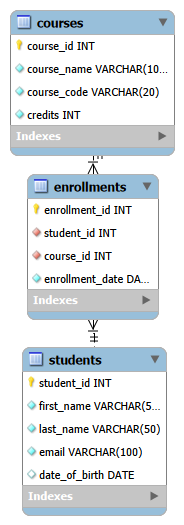

# Student Management System

A desktop-based Student Management System developed using **Python, Tkinter, and MySQL**. This application allows users to manage student records through a graphical user interface connected to a relational database.

## Features

- Add new student records
- View student records in a table
- Update existing student details
- Delete student records
- Search students by ID, first name, last name, or email
- Display all student records
- Validate user inputs
- Store database configuration using environment variables

## Technologies Used

- **Python** — application logic
- **Tkinter** — graphical user interface
- **MySQL** — relational database
- **mysql-connector-python** — Python–MySQL connectivity
- **python-dotenv** — environment variable configuration
- **Git and GitHub** — version control

## Project Structure

```text
student-management-system/
├── app/
│   └── main.py
├── database/
│   ├── schema.sql
│   ├── sample_data.sql
│   ├── queries.sql
│   ├── ERD.md
│   └── README.md
├── docs/
│   ├── StudentManagementSystem.png
│   └── StudentManagementSystem.mwb
├── .env.example
├── .gitignore
├── requirements.txt
└── README.md
```

*Note: The structure above describes the intended repository layout. Adjust filenames to match the files actually committed to GitHub.*

## Prerequisites

Before running the application, install:

- Python 3
- MySQL Server
- Git (optional, for cloning the repository)

## Database Setup

1. Start your MySQL server.
2. Open MySQL Workbench or another MySQL client.
3. Create the database and tables using `database/schema.sql`.
4. Optionally import `database/sample_data.sql` to insert sample student records.
5. Review `database/queries.sql` for example SQL queries.

Run the SQL files in the order described above. Check that the database name matches the application configuration.

## Installation

### 1. Clone the repository

```bash
git clone https://github.com/ShenesFernando/student-management-system.git
cd student-management-system
```

### 2. Create a virtual environment

**Windows PowerShell:**

```powershell
python -m venv .venv
.\.venv\Scripts\Activate.ps1
```

### 3. Install dependencies

```powershell
python -m pip install -r requirements.txt
```

### 4. Configure environment variables

Create a file named `.env` in the project root directory:

```env
DB_HOST=localhost
DB_USER=root
DB_PASSWORD=your_mysql_password
DB_NAME=student_management
```

Replace `your_mysql_password` with your own MySQL password.

**Security:** Never commit your real `.env` file or database password to GitHub. Use `.env.example` to document required variables without including secrets.

### 5. Run the application

From the project root, run:

```powershell
python app/main.py
```

## Usage

1. Enter the student's first name, last name, email, and date of birth.
2. Use **Add Student** to create a record.
3. Select a student from the table to load their details for updating or deleting.
4. Use the search field to find students by ID, name, or email.
5. Select **Show All** or **Refresh Students** to reload the records.

## Screenshots

Add screenshots of the application interface here to demonstrate the graphical user interface and student management features.

## Database Design

The database design documentation and SQL scripts are available in the `database/` directory. The ER diagram and MySQL Workbench model are stored in `docs/` if included in the repository.

## Entity Relationship Diagram

The following diagram illustrates the database structure and
relationships used in the Student Management System.



## Future Improvements

- Improve the interface design and usability
- Add stronger validation and error handling
- Implement user authentication and role-based access
- Add automated tests
- Package the application for easier installation

## Author

**Shenes Fernando**

This project was developed as a learning and portfolio project to practise Python desktop application development, relational database design, SQL, and version control.
